

  <picture>
    <source media="(max-width: 700px)" srcset="assets/mobile/header-en-m.png">
    <source srcset="assets/header-en.webp" type="image/webp">
    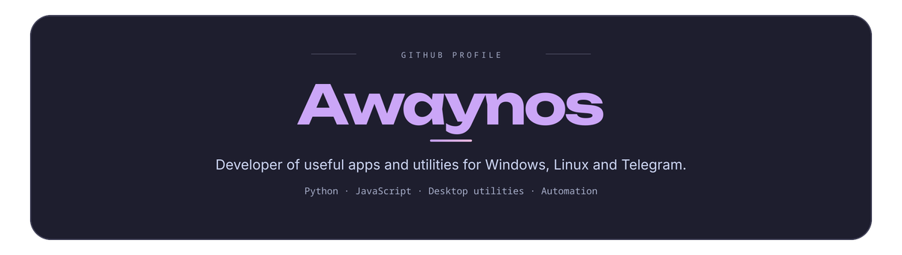
  </picture>

  <a href="https://awaynos.github.io/Awaynos/">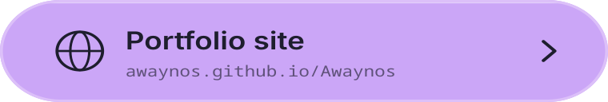</a>
  &nbsp;&nbsp;
  
  &nbsp;&nbsp;
  

  
  &nbsp;
  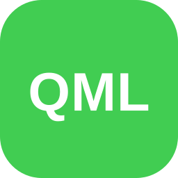
  &nbsp;
  
  &nbsp;
  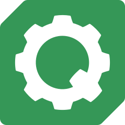
  &nbsp;
  

<picture><source media="(max-width: 700px)" srcset="assets/mobile/section-profile-en-m.png">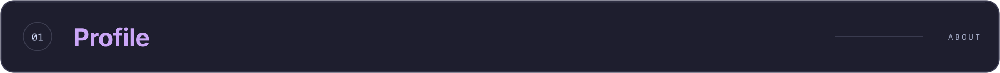</picture>

| | |
|---|---|
| **Focus** | Apps and utilities for Windows and Linux · Telegram tools · networking solutions · web development · AI integration and training |
| **Core stack** | Python (PySide6, Telethon) · JavaScript / Electron · TypeScript |
| **Platform** | Windows / Linux |
| **Approach** | Practical tools built for a specific job: portable, with no unnecessary dependencies |
| **Licenses** | Open source (MIT, PolyForm Noncommercial) |

<picture><source media="(max-width: 700px)" srcset="assets/mobile/section-projects-en-m.png">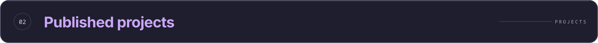</picture>

  <a href="https://github.com/Awaynos/QTranslate-R"><picture><source media="(max-width: 700px)" srcset="assets/mobile/project-qtranslate-en-m.png">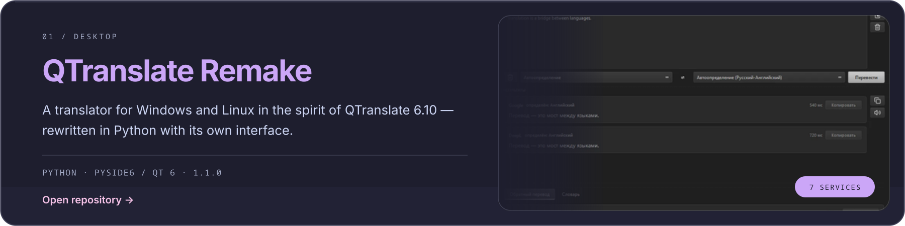</picture></a>

**A translator for Windows and Linux in the spirit of QTranslate 6.10** — rewritten in Python with its own interface.

`Python 3.11` · `PySide6 / Qt 6` · `1.1.0`

- Global hotkeys: `Ctrl+Q` translates the selection, `Ctrl+1` replaces text with the translation in place, `Ctrl+I` runs OCR on screen text, `Ctrl+E` speaks the translation, `Ctrl+D` opens the dictionary. On Linux the defaults are `Ctrl+Alt+Q/1/I`; on Wayland use your desktop's keybindings
- Seven translation services at once: Google, Bing, DeepL, Yandex, Reverso, MyMemory, LibreTranslate
- Document translation: TXT, SRT, VTT, DOCX, PDF — with timings and structure preserved
- Spell check and a custom CSV glossary — your data never leaves the machine
- Linux: X11 and Wayland, AppImage, `tar.gz` and an Arch package; global hotkeys on Wayland are set through desktop keybindings
- Frameless interface: 4 themes, 13 languages (ru/en/de/fr/es/ko/pt-BR/zh/ja/kk/ka/be/pl), history, tray

[**Website**](https://awaynos.github.io/QTranslate-R/) · [**Repository**](https://github.com/Awaynos/QTranslate-R) · [**Releases**](https://github.com/Awaynos/QTranslate-R/releases)

  <a href="https://github.com/Awaynos/QMessages"><picture><source media="(max-width: 700px)" srcset="assets/mobile/project-qmessages-en-m.png">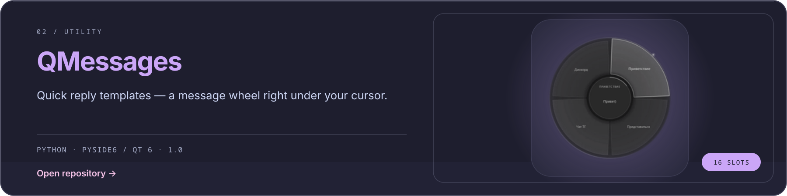</picture></a>

**Quick reply templates — a message wheel right under your cursor.**

`Python 3.11` · `PySide6 / Qt 6` · `1.0`

- Hold the hotkey → pick a message → release: the text is already in the chat
- Up to 16 messages: a short label on the wheel and the full text to paste
- Paste via clipboard (Ctrl+V) or character by character; optionally send with Enter
- Restores the clipboard contents; templates and settings live in `%APPDATA%\QMessages\config.json`
- Portable build, dark Metal theme, tray; no telemetry, accounts or cloud

[**Repository**](https://github.com/Awaynos/QMessages) · [**Releases**](https://github.com/Awaynos/QMessages/releases)

  <a href="https://github.com/Awaynos/crm-case-study"><picture><source media="(max-width: 700px)" srcset="assets/mobile/project-crm-en-m.png">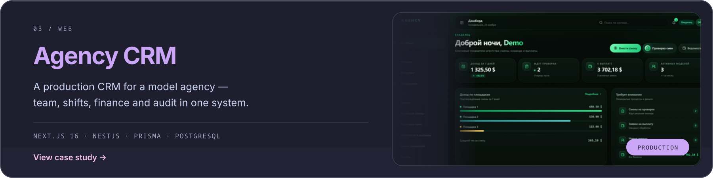</picture></a>

**A production CRM for a model agency** — team, shifts, finance, access, files and audit in one system.

`Next.js 16` · `NestJS` · `Prisma` · `PostgreSQL`

- Seven roles, hierarchy and object-level access restrictions
- Shifts, accruals, payouts and reports based on the active distribution scheme
- Mandatory 2FA, email confirmation, EULA and audit of critical actions
- Encrypted files and external links issued by role
- Production case: the source is private, the showcase and screenshots are public

[**Case study**](https://github.com/Awaynos/crm-case-study)

  <a href="https://github.com/Awaynos/eft-map-overlay"><picture><source media="(max-width: 700px)" srcset="assets/mobile/project-eft-en-m.png">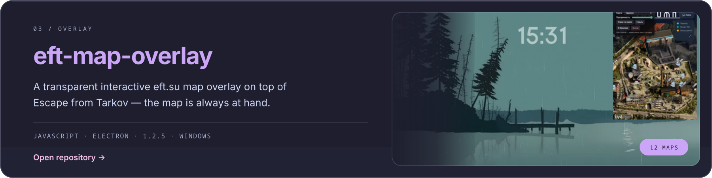</picture></a>

**A transparent interactive eft.su map overlay on top of Escape from Tarkov** — the map is always at hand, so you orient yourself faster.

`JavaScript` · `Electron` · `1.2.5` · `Windows`

- Does not read game memory or inject anything — a legal external overlay, safe for BattlEye
- Hotkeys: switch clicks between game ⇄ map, show/hide, opacity, quick map switch
- Click-through: the map stays visible, but aiming and shooting are never blocked
- Auto-updates from GitHub, remembers settings (map, opacity, window position)
- 12 maps: Factory, Customs, Woods, Lighthouse, Shoreline, Reserve, Interchange, Streets of Tarkov, Labs, Ground Zero, Labyrinth, Icebreaker

[**Repository**](https://github.com/Awaynos/eft-map-overlay) · [**Releases**](https://github.com/Awaynos/eft-map-overlay/releases)

<picture><source media="(max-width: 700px)" srcset="assets/mobile/section-stats-en-m.png"></picture>


 

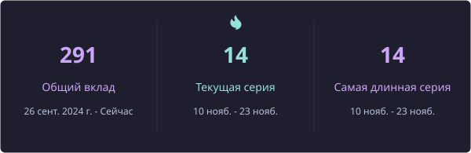

<picture><source media="(max-width: 700px)" srcset="assets/mobile/section-support-en-m.png"></picture>

Development and maintenance take time — I would be grateful for your support. It is completely optional: you can also help without money — report a bug, suggest an idea, or simply star a project.

<picture><source media="(max-width: 700px)" srcset="assets/mobile/section-contacts-en-m.png"></picture>

- GitHub — [@Awaynos](https://github.com/Awaynos)
- Telegram channel — [@awadeveloper](https://t.me/awadeveloper)
- Discussion chat — [t.me/awadeveloperchat](https://t.me/awadeveloperchat)
- Portfolio — [awaynos.github.io/Awaynos](https://awaynos.github.io/Awaynos/)
- Bugs, ideas and pull requests — via Issues in the relevant repositories
