

  <picture>
    <source media="(max-width: 700px)" srcset="assets/mobile/header-ru-m.png">
    <source srcset="assets/header.webp" type="image/webp">
    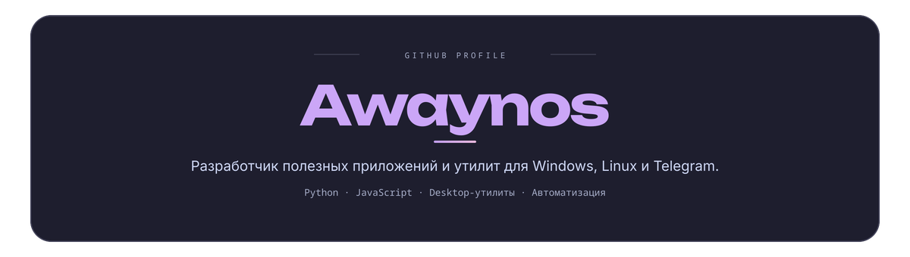
  </picture>

  <a href="https://awaynos.github.io/Awaynos/">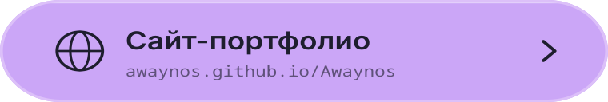</a>
  &nbsp;&nbsp;
  
  &nbsp;&nbsp;
  

  
  &nbsp;
  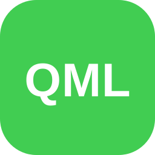
  &nbsp;
  
  &nbsp;
  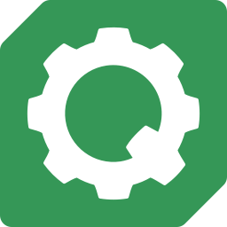
  &nbsp;
  

<picture><source media="(max-width: 700px)" srcset="assets/mobile/section-profile-ru-m.png">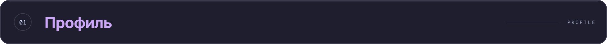</picture>

| | |
|---|---|
| **Направления** | Приложения и утилиты для Windows и Linux · инструменты для Telegram · сетевые решения · разработка сайтов · интеграция и обучение ИИ |
| **Основной стек** | Python (PySide6, Telethon) · JavaScript / Electron · TypeScript |
| **Платформа** | Windows / Linux |
| **Подход** | Прикладные инструменты под конкретную задачу: портативные, без лишних зависимостей |
| **Лицензии** | Открытый исходный код (MIT, PolyForm Noncommercial) |

<picture><source media="(max-width: 700px)" srcset="assets/mobile/section-projects-ru-m.png">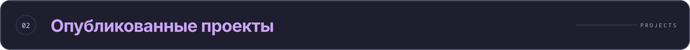</picture>

  <a href="https://github.com/Awaynos/QTranslate-R"><picture><source media="(max-width: 700px)" srcset="assets/mobile/project-qtranslate-ru-m.png">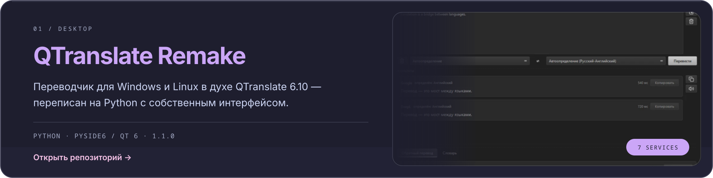</picture></a>

**Переводчик для Windows и Linux в духе QTranslate 6.10** — переписан на Python с собственным интерфейсом.

`Python 3.11` · `PySide6 / Qt 6` · `1.1.0`

- Глобальные горячие клавиши: `Ctrl+Q` — перевод выделенного, `Ctrl+1` — замена текста переводом на месте, `Ctrl+I` — распознавание текста с экрана (OCR), `Ctrl+E` — озвучка, `Ctrl+D` — словарь. В Linux по умолчанию `Ctrl+Alt+Q/1/I`; на Wayland — бинды DE
- Семь сервисов перевода одновременно: Google, Bing, DeepL, Yandex, Reverso, MyMemory, LibreTranslate
- Перевод документов: TXT, SRT, VTT, DOCX, PDF — с сохранением таймингов и структуры
- Проверка орфографии; собственный CSV-словарь (глоссарий, аббревиатуры) — данные не покидают машину
- Linux: X11 и Wayland, AppImage, `tar.gz` и пакет для Arch; глобальные хоткеи на Wayland задаются биндами DE
- Интерфейс без системной рамки: 4 темы, 13 языков (ru/en/de/fr/es/ko/pt-BR/zh/ja/kk/ka/be/pl), история, трей

[**Сайт**](https://awaynos.github.io/QTranslate-R/) · [**Репозиторий**](https://github.com/Awaynos/QTranslate-R) · [**Релизы**](https://github.com/Awaynos/QTranslate-R/releases)

  <a href="https://github.com/Awaynos/QMessages"><picture><source media="(max-width: 700px)" srcset="assets/mobile/project-qmessages-ru-m.png">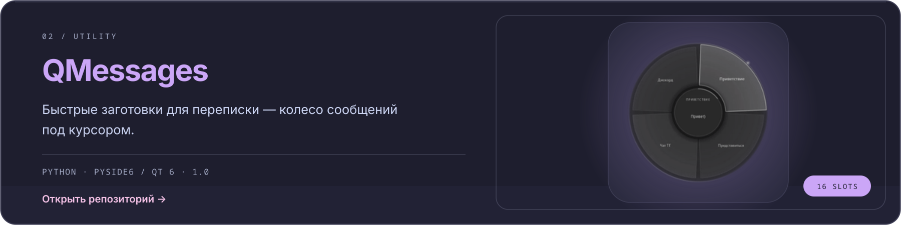</picture></a>

**Быстрые заготовки для переписки — колесо сообщений под курсором.**

`Python 3.11` · `PySide6 / Qt 6` · `1.0`

- Колесо заготовок: зажал бинд → выбрал сообщение → отпустил — текст уже в чате
- До 16 сообщений: короткая подпись на колесе и полный текст для вставки
- Вставка через буфер (Ctrl+V) или посимвольно; опциональная отправка по Enter
- Возврат содержимого буфера обмена, заготовки и настройки в `%APPDATA%\QMessages\config.json`
- Портативная сборка, тёмная тема Metal, трей; без телеметрии, аккаунтов и облака

[**Репозиторий**](https://github.com/Awaynos/QMessages) · [**Релизы**](https://github.com/Awaynos/QMessages/releases)

  <a href="https://github.com/Awaynos/crm-case-study"><picture><source media="(max-width: 700px)" srcset="assets/mobile/project-crm-ru-m.png">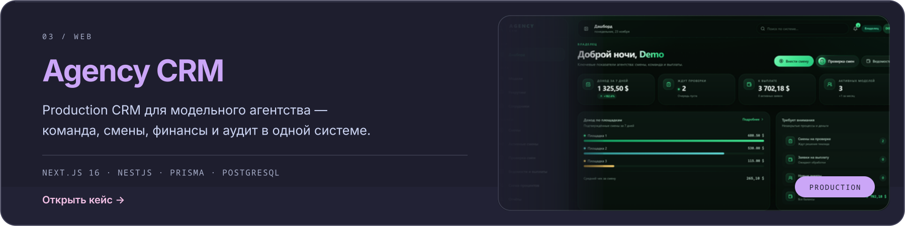</picture></a>

**Production CRM для модельного агентства** — команда, смены, финансы, доступы, файлы и аудит в одной системе.

`Next.js 16` · `NestJS` · `Prisma` · `PostgreSQL`

- Семь ролей, иерархия и объектные ограничения доступа
- Смены, начисления, выплаты и отчёты по активной схеме распределения
- Обязательная 2FA, подтверждение email, EULA и аудит критичных действий
- Зашифрованные файлы и внешние ссылки с выдачей по ролям
- Production-кейс: исходный код приватный, витрина и скриншоты открыты

[**Кейс**](https://github.com/Awaynos/crm-case-study)

  <a href="https://github.com/Awaynos/eft-map-overlay"><picture><source media="(max-width: 700px)" srcset="assets/mobile/project-eft-ru-m.png">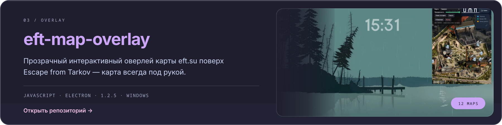</picture></a>

**Прозрачный интерактивный оверлей карты eft.su поверх Escape from Tarkov** — карта всегда под рукой, ориентирование быстрее.

`JavaScript` · `Electron` · `1.2.5` · `Windows`

- Не читает память игры и ничего не инжектит — легальный внешний оверлей, безопасный для BattlEye
- Горячие клавиши: переключение кликов игра ⇄ карта, показать/скрыть, прозрачность, быстрая смена карты
- Сквозные клики: карта видна, но прицел и стрельба не блокируются
- Автообновление с GitHub, запоминание настроек (карта, прозрачность, положение окна)
- 12 карт: Завод, Таможня, Лес, Маяк, Берег, Резерв, Развязка, Улицы Таркова, Лаборатория, Эпицентр, Лабиринт, Ледокол

[**Репозиторий**](https://github.com/Awaynos/eft-map-overlay) · [**Релизы**](https://github.com/Awaynos/eft-map-overlay/releases)

<picture><source media="(max-width: 700px)" srcset="assets/mobile/section-stats-ru-m.png">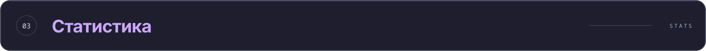</picture>


 

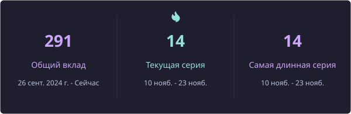

<picture><source media="(max-width: 700px)" srcset="assets/mobile/section-support-ru-m.png">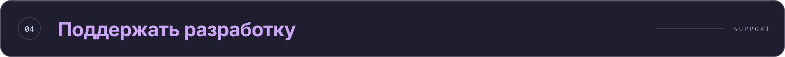</picture>

Разработка и поддержка проектов занимает время — буду благодарен за поддержку. Поддержка полностью необязательна: можно помочь и без денег — сообщить о баге, предложить идею или просто поставить звезду проекту.

> **Важно:** отправляйте перевод **только в указанной сети** — перевод в другой сети может быть потерян безвозвратно.

| Монета | Сеть | Адрес |
|:---|:---|:---|
|  | 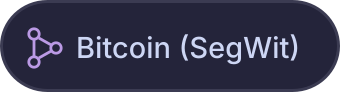 | `bc1qfaylkgnwct052snamqmnxl3uk26xpt5jg344fs` |
|  | 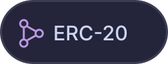 | `0x44628629c1C6f8E8591d4f93735Ff6CD70DC8AfC` |
| 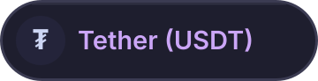 | 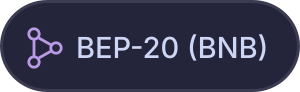 | `0x44628629c1C6f8E8591d4f93735Ff6CD70DC8AfC` |
|  | 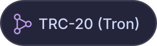 | `TREypoEUmW7KDkbpSxDGsnCnA6SQ1e8SVk` |
| 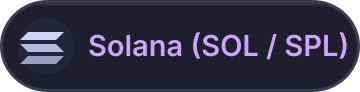 |  | `3sTNRxJqATsJsKWyM5dxi4HHMLEKbp8f8dGU4wJ1xmE9` |

> **USDT:** BEP-20 (BNB) и TRC-20 (Tron) — разные сети. Адреса не взаимозаменяемы.

<picture><source media="(max-width: 700px)" srcset="assets/mobile/section-contacts-ru-m.png"></picture>

- GitHub — [@Awaynos](https://github.com/Awaynos)
- Telegram-канал — [@awadeveloper](https://t.me/awadeveloper)
- Чат для обсуждений — [t.me/awadeveloperchat](https://t.me/awadeveloperchat)
- Портфолио — [awaynos.github.io/Awaynos](https://awaynos.github.io/Awaynos/)
- Баги, идеи и pull request'ы — через Issues в соответствующих репозиториях
